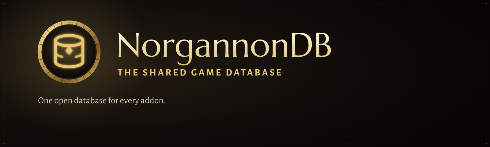

<p align="center">
  
</p>

<p align="center">
  
  
  
  
</p>

> [!WARNING]
> **Very much a work in progress.** This is an early build for WoW Forever (client 1.60.1), in
> active development and testing. Expect missing features, rough edges, bugs, and changes that
> break things between versions. Bug reports and feedback are welcome in
> [Issues](../../issues).

**NorgannonDB is an open, crowd-sourced game database for WoW Forever**, packaged as an add-on any
other add-on can load. It's the record behind the NorgannonDB suite, and it's free for anyone to
build on.

## What's inside

- **Quests**: givers, turn-ins, objectives, requirements, chains and rewards.
- **Creatures and objects**: where they spawn, what they drop and how often, what vendors sell,
  and the town services they offer.
- **Items**: where every item comes from, whether dropped, sold, rewarded or crafted.
- **Dungeons and raids**: wings, bosses in order, each boss's own loot, keys and attunements.
- **Professions**: every recipe with its skill-up colours, reagents, and where to learn it, using
  WoW Forever's own recipes and numbers.
- **Zones, maps and tracking lists**: flight masters, innkeepers, herbs, ore, rares and more.
- **Nine languages** besides English.

### Built for WoW Forever, and getting better as you play

NorgannonDB starts from the best community data, QuestieDB and pfQuest, and reads WoW Forever's own
game tables where Forever changed things. What's still missing or different on Forever, players
fill in by playing with the **[NorgannonDB Collector](https://github.com/zmarotrix/NorgannonDBCollector)**.

## The NorgannonDB suite

|   | Add-on | |
|:-:|---|---|
|  | **[Clairvoyance](https://github.com/zmarotrix/Clairvoyance)** | Quest helper: your objectives on the map, minimap and compass, and a modern tracker |
|  | **[Oracle](https://github.com/zmarotrix/Oracle)** | Dungeon and zone atlas: maps, bosses, loot, zones and professions |
|  | **NorgannonDB** | The open game database underneath, with **[NorgannonDB Core](https://github.com/zmarotrix/NorgannonDB_Core)**, the shared runtime |
|  | **[NorgannonDB Collector](https://github.com/zmarotrix/NorgannonDBCollector)** | Help map Azeroth: improves the database while you play |
|  | Foresight | Planner. *Coming later* |
|  | Archivum | Look anything up in game. *Coming later* |

## Getting started

You don't use NorgannonDB on its own: install it with the add-ons that need it. Download it (**Code →
Download ZIP**), extract it into your WoW Forever `Interface/AddOns` folder, and rename the folder
from `NorgannonDB-main` to `NorgannonDB`.

---

## Technical details

<details>
<summary><b>Using it in your own add-on</b></summary>

The data contract is [SPEC.md](SPEC.md) (schema 1.4): record shapes, coordinates, localization,
player variants, corrections and the relation indexes.

```lua
-- in your TOC:  ## Dependencies: NorgannonDB
local DB = NorgannonDB
if not DB or not DB:RequireSchema(1, 4) then return end
local quest = DB:Get("quests", 788)
local recipe = DB.recipes[2158]
```

</details>

<details>
<summary><b>Sources and credits</b></summary>

| Source | What it gives | Licence |
|---|---|---|
| [QuestieDB / Questie](https://github.com/Questie/Questie) | quests, NPCs, objects and items; the source of truth | GPL-3.0 |
| [pfQuest](https://github.com/shagu/pfQuest) by Shagu | drop chances, extra objectives, translations | MIT |
| DungeonJournal by Exehn | WoW Forever's own instances, bosses and loot | used with the author's permission |
| [cmangos classic-db](https://github.com/cmangos/classic-db) | recipe sources, trainers, disenchanting | GPL-3.0 |
| NorgannonDB Collector players | what they recorded in game | the Collector's terms |

Full notices: [NOTICE.md](NOTICE.md).

</details>

<details>
<summary><b>Licence</b></summary>

NorgannonDB is free software under the [GNU General Public License v3.0](LICENSE), because it
contains data from QuestieDB. Compiled and maintained by **Maro**.

</details>
